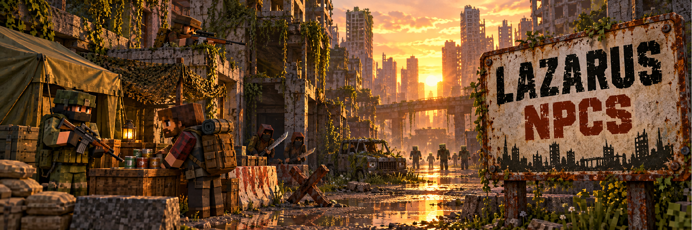

<p align="center">
  
</p>

<p align="center">
  
  
  
  
</p>

# Lazarus NPCs

**Lazarus NPCs** é um mod para Minecraft Forge 1.20.1 criado para o modpack **Project Lazarus**. Ele dá vida às pessoas que restaram no apocalipse: os sobreviventes, militares, caçadores, saqueadores, soldados desertores e canibais do **Apocalypse Now** passam a negociar, pedir ajuda, cobrar pedágio, perseguir, se render e lutar com armas do **TaCZ**.

O mod não cria novas entidades nem altera o JAR do Apocalypse Now. Tudo é feito sobre os NPCs originais, com servidor autoritativo e suporte a multiplayer.

---

## Sumário

- [Interação e trocas](#interação-e-trocas)
- [Facções e reputação](#facções-e-reputação)
- [Tarefas e serviços](#tarefas-e-serviços)
- [Escolta e guarda de bases](#escolta-e-guarda-de-bases)
- [Encontros hostis](#encontros-hostis)
- [Rendição](#rendição)
- [Armas de fogo](#armas-de-fogo)
- [Comandos e configuração](#comandos-e-configuração)
- [Instalação](#instalação)
- [O que vem do Apocalypse Now](#o-que-vem-do-apocalypse-now)
- [Créditos e licença](#créditos-e-licença)

---

## Interação e trocas

- Clique com a **mão vazia** em um sobrevivente, militar, médico militar ou caçador para abrir a tela do NPC, com as abas **Trade**, **Services**, **Tasks** e, quando disponível, **Guard**.
- Cada NPC recebe um **nome persistente**, falas por facção, nome colorido no chat e uma saudação com voz posicional. Os sons genéricos de aldeão são suprimidos apenas nesses NPCs.
- Cada NPC oferece uma seleção rotativa de um catálogo amplo, por papel e por facção. Militares podem vender armas e munição do TaCZ, roupas militares, armaduras e equipamento de campo.
- As ofertas têm estoque limitado e se renovam após **48.000 ticks de servidor ativo** (cerca de 40 minutos); dormir não reabastece.
- Só um jogador negocia com o mesmo NPC por vez, e a troca fecha se o NPC se afastar mais de oito blocos.
- O **diário** fica no inventário, entre o retrato do jogador e a grade de criação. Ele mostra a tarefa atual, a reputação com cada facção e, na página **Contracts**, as escoltas e os guardas contratados.

---

## Facções e reputação

| Facção | NPCs | Foco |
|---|---|---|
| **Haven** | Sobreviventes 1 a 3 | Comida e cuidados |
| **Rovers** | Sobreviventes 4 a 6 | Viagem e sucata |
| **Wardens** | Sobreviventes 7 e 8 | Proteção |
| **Military** | Militares e médico militar | Suprimentos e equipamento |
| Independentes | Sobreviventes 9 e 10, caçador | Sem reputação compartilhada |

- Cada troca concluída com um NPC afiliado rende **+1** com a facção. Ferir um NPC afiliado custa **5** (uma vez por NPC por minuto, não importa quantos golpes ou tiros) e matá-lo custa mais **20**.
- A reputação vai de **-100 a 100**, sobrevive à morte do jogador e se recupera em **5 pontos por dia** de jogo quando negativa.
- A partir de **10** de confiança, o primeiro item da troca custa um a menos; a partir de **30**, dois a menos (nunca abaixo de um).
- Em **-20** ou menos, a facção recusa trocas e serviços.
- Em **-40** ou menos, você vira **inimigo**: os NPCs da facção atacam ao te ver, e todas as escoltas e guardas dela são encerrados. O diário marca a facção como **ENEMY**.
- **Revide:** atacar um NPC de facção faz ele e os NPCs da mesma facção num raio de 16 blocos lutarem contra você por um minuto. Jogadores em Creative ou espectador nunca são alvo.
- Concluir uma tarefa dos Rovers reduz em 1 a reputação com os Wardens, e vice-versa.

---

## Tarefas e serviços

**Tarefas.** Clique agachado em um sobrevivente, médico ou militar com a mão vazia, ou use a aba **Tasks**. Os pedidos variam por papel e facção: comida, água, pano, sucata, suprimentos médicos ou infectados abatidos nas redondezas. Entregue a qualquer NPC do mesmo papel e facção. Uma tarefa por vez, válida por 48.000 ticks, com espera de 6.000 ticks para repetir o mesmo papel. As recompensas usam itens do Apocalypse Now e do TaCZ e aumentam a reputação.

**Serviços.** Disponíveis na aba **Services** ou com `/lazarusnpcs services`, a até seis blocos do NPC:

| Serviço | NPC | Custo | Efeito |
|---|---|---|---|
| Reparo | Sobrevivente | 3 barras de ferro | Recupera 25% da durabilidade do item na mão (espera de 5 min) |
| Tratamento | Médico militar | 2 bandagens e 1 água enlatada | Recupera 4 corações e remove veneno e fraqueza (espera de 2 min) |
| Reconhecimento | Caçador | 1 comida enlatada | Direção e quantidade de infectados próximos, e o baú intocado mais próximo num raio de 48 blocos (espera de 3 min) |
| Escolta | Militar | 3 comidas enlatadas e 2 barras de ferro | Acompanhamento por 5 minutos |
| Guarda | Militar ou Wardens | 4 comidas enlatadas, 2 águas enlatadas e 3 barras de ferro por dia | Protege uma área da sua base |

O tratamento recupera a vida comum e não cura ferimentos ou infecções de outros mods. O reconhecimento só lê chunks já carregados e nunca abre nem gera o loot.

---

## Escolta e guarda de bases

### Escolta

- O militar fica **3 a 6 blocos atrás**, sai da frente em vez de empurrar e percorre longas distâncias em trechos curtos. Ele **nunca teleporta**.
- Ele ataca quem te fere e quem você ataca, não persegue a mais de 16 blocos de você e volta a te seguir depois da luta.
- O contrato termina quando o tempo acaba, quando você ou ele morre, quando você muda de dimensão, após 30 segundos sem contato ou quando ele fica 45 segundos sem conseguir se aproximar (o aviso aparece aos 20).
- Se você desconectar, ele espera no lugar até o contrato vencer. Uma escolta por jogador.

### Guarda de bases

- Disponível em militares e sobreviventes **Wardens**, com pelo menos **10** de confiança com a facção.
- Fique no ponto que quer proteger, a até 32 blocos do NPC, escolha a área de **6, 10 ou 14 blocos** na aba **Guard** e clique em **Guard here**.
- O guarda caminha até o posto (o pagamento é devolvido se ele não chegar em um minuto), permanece ali e combate infectados, humanos hostis e outros monstros dentro da área. Creepers são ignorados, alvos que saem da área são abandonados e guardas nunca lutam contra jogadores.
- Cada contrato dura **um dia de jogo** (cerca de 20 minutos); renovações acumulam até **três dias**.
- **Limites:** 2 guardas por jogador, 12 por servidor e um contrato por NPC.
- Só quem contratou pode renovar, mudar a área ou dispensar o guarda. Operadores podem dispensar qualquer um. Os outros jogadores veem para quem ele trabalha.
- Os contratos sobrevivem a chunks descarregados e reinícios, vencem pelo tempo do mundo mesmo descarregados e só impedem o despawn enquanto estão ativos.
- **Fogo amigo:** a escolta ou o guarda perdoa um golpe seu por engano. Um segundo golpe em até 30 segundos encerra o contrato e ele revida.

---

## Encontros hostis

**Saqueadores (looters).** Avisam o grupo inteiro antes de atacar. Durante os 10 segundos de aviso, clique com a mão vazia para abrir a negociação: pague **2 comidas enlatadas** para passar por cinco minutos, ou saia da área. Atacar um deles provoca o grupo. Grupos de dois ou mais têm um **vigia** com luneta, que avista de 24 blocos, mantém distância e dá o sinal para os combatentes. O grupo se dispersa quando perde metade dos membros (o vigia conta em dobro) ou quando a vida somada cai abaixo de 40%.

**Soldados desertores.** Mantêm um **posto de controle** onde surgiram. Avisam a 20 blocos, mas só atacam quem cruza a linha de 12 blocos do posto depois do aviso, ou quem os ataca. O pedágio é de **2 comidas enlatadas e 2 barras de ferro**. Em combate, chamam os companheiros, buscam cobertura contra armas de longo alcance e flanqueiam pelos lados. Equipamento de valor é raro no loot: armadura em 3% por peça, e nada de kits de armas.

**Canibais.** À noite, perseguem o jogador mais isolado em vez de atacar de frente. Seguem por trás, recuam quando observados e dão pelo menos dois sinais (passos, um galho quebrando, uma mensagem) antes do aviso e da emboscada. Recuam quando feridos, se afastam com a luz do dia e não negociam.

**Caçador.** Independente. Ataca os infectados que o mod original ignorava (incluindo os do Undead Revamped e do The Hordes), ajuda jogadores atacados por infectados num raio de 20 blocos e recua com 25% de vida.

Os avisos voltam a valer depois de cinco minutos, e cada jogador é tratado separadamente: quem pagou não protege quem está ao lado.

**Geração** (regras de spawn do perfil): saqueadores a partir do dia 6; caçadores e canibais a partir do dia 10; soldados desertores a partir do dia 20. Os encontros acontecem ao ar livre.

---

## Rendição

Um saqueador ou soldado desertor muito ferido pode se render. A chance é sorteada **uma única vez por NPC**, quando ele cai para 35% de vida lutando contra jogadores ou seus contratados.

| Situação | Efeito na chance |
|---|---|
| Saqueador | Base de 45% |
| Soldado desertor | Base de 20% |
| O grupo ainda é maior que o lado do jogador | Metade |
| Abaixo de 20% de vida | +15% |
| O grupo já perdeu membros | +10% |
| Grupo com vantagem de 2 para 1 | Não se rende |
| Canibal | Nunca se rende |

O limite é de 80%. Quem se rende larga a arma (ela não cai no chão), ganha uma etiqueta de nome, para de lutar e espera um minuto. Só quem o rendeu pode abrir o painel: **Take supplies** entrega um pacote fixo e modesto (saqueador: 1 comida enlatada e talvez uma bandagem; soldado: 1 comida enlatada e 2 barras de ferro), e **Let them go** o libera. Nos dois casos ele vai embora e some quando sai de vista. Matar um prisioneiro não rende loot, XP nem carne humana e custa **3** de confiança com os Wardens.

---

## Armas de fogo

Alguns NPCs nascem com uma arma do **TaCZ** do arsenal da sua facção. O sorteio acontece uma vez por NPC e fica salvo nele.

| Facção / tipo | Chance | Arsenal |
|---|---:|---|
| Militares | 25% | M4A1, M16A4, MP5, SCAR-L, M9A4, M870 |
| Médico militar | 12% | M9A4, Glock 17 |
| Soldados desertores | 20% | AK-47, Type 81, SKS, M1911, Uzi, RPK (rara) |
| Saqueadores | 10% | Glock 17, M1911, cano duplo curto, CZ75, Uzi, Taurus 943 |
| Caçador | 30% | M700, Kar98, Springfield 1873, cano duplo longo, M870 |
| Haven | 6% | Glock 17, M1911, cano duplo curto |
| Rovers | 10% | M870, cano duplo longo, Taurus 943, Rhino 357, SKS |
| Wardens | 14% | M1014, MP5, UMP45, P320, M700 |
| Sobreviventes independentes | 6% | Glock 17, cano duplo curto, M1911 |
| Canibais | Nunca | — |

- Lança-foguetes, metralhadoras e rifles .50 ficam de fora.
- Com linha de tiro livre, o NPC para e atira em rajadas curtas: pistolas e escopetas até 16 blocos, submetralhadoras até 20 e rifles até 28. A pontaria tem erro proposital (saqueadores erram mais; caçadores e militares, menos). A menos de 3,5 blocos ou sem linha de tiro, ele volta ao corpo a corpo.
- Os NPCs recarregam fazendo uma pausa e não carregam munição.
- Os tiros de NPCs causam **metade do dano** em jogadores, nunca ferem a própria facção ou grupo, e NPCs aliados não acertam jogadores com quem não estão hostis.
- A arma cai em **12%** das mortes causadas por jogadores, sempre com o **carregador vazio**.

---

## Comandos e configuração

| Comando | Quem | Efeito |
|---|---|---|
| `/lazarusnpcs reputation` | Todos | Mostra a reputação com cada facção |
| `/lazarusnpcs reputation set <facção> <valor>` | Operador | Define a reputação (testes) |
| `/lazarusnpcs task` / `task abandon` | Todos | Progresso da tarefa / abandona a tarefa |
| `/lazarusnpcs task reset` | Operador | Repete cenários de tarefa imediatamente |
| `/lazarusnpcs services` | Todos | Lista os serviços dos NPCs próximos |
| `/lazarusnpcs contracts` / `contracts release` | Todos | Mostra / encerra suas escoltas e guardas |
| `/lazarusnpcs spawn <tipo> [x y z]` | Operador | Cria um NPC do Apocalypse Now para teste |
| `/lazarusnpcs debug` / `debug reset` | Operador | Custo medido de cada rotina de IA e número de contratos |

Na primeira execução, o mod cria `config/lazarus-npcs-trades.json`, com as listas `survivor`, `hunter`, `medic` e `military`, e as listas opcionais `haven`, `rovers` e `wardens`. Edite IDs, quantidades, estoque (`uses`) e a cura do tratamento, e reinicie o jogo ou o servidor. Ofertas inválidas são ignoradas e registradas no log. O catálogo padrão está em [`src/main/resources/default_trades.json`](src/main/resources/default_trades.json).

`config/lazarus-npcs.toml` controla o volume das vozes, a frequência das saudações e a supressão dos sons de aldeão.

O script [`scripts/patch_soldier_loot.py`](scripts/patch_soldier_loot.py) ajusta as tabelas de loot dos soldados no perfil do modpack, para que o equipamento valioso seja raro e coerente com o que eles carregam.

---

## Instalação

### Requisitos

- **Minecraft 1.20.1**
- **Minecraft Forge 47.x** (desenvolvido com 47.4.10)
- **Java 17**
- **Apocalypse Now 3.0.5** ou superior (e o **Curios**, exigido por ele)
- **TaCZ 1.1.8** ou superior, com o pacote de armas padrão

### Jogadores e servidores

1. Baixe [`lazarusnpcs-1.0.0.jar`](dist/lazarusnpcs-1.0.0.jar) e instale os mods exigidos acima.
2. Coloque o JAR na pasta `mods` do perfil. No CurseForge, clique com o botão direito no perfil e escolha **Open Folder**.
3. Em multiplayer, instale a **mesma versão** no servidor e em todos os clientes. Versões com protocolo diferente recusam a conexão em vez de falhar.
4. Remova qualquer JAR antigo `lazarusnpcs` antes de atualizar e reinicie o Minecraft.

Mundos existentes funcionam sem preparo: NPCs já salvos recebem nomes, catálogo e o sorteio de arma na primeira vez em que são carregados, e marcas de escolta das versões anteriores são limpas.

### Compilar a partir do código

Os JARs dos mods usados na compilação e nos testes não são redistribuídos. Copie-os do seu perfil para `libs/` com estes nomes:

| Arquivo em `libs/` | Mod |
|---|---|
| `apocalypsenow-3.0.5.jar` | Apocalypse Now 3.0.5 |
| `curios-5.14.1.jar` | Curios 5.14.1 para 1.20.1 |
| `tacz-1.1.8.jar` | TaCZ 1.1.8 para 1.20.1 |

Com JDK 17 instalado, execute na raiz do projeto:

```bash
gradlew build
```

O JAR compilado fica em `build/libs/`. O `build` também roda as verificações unitárias.

```bash
gradlew runGameTestServer
```

Esse comando sobe um servidor 1.20.1 sem interface, com os mods de `libs/`, e roda os **29 GameTests** dentro do mundo: escolta (seguir, defender, prazo, morte do NPC e do dono, dimensão, NPC preso, dono offline e reconexão), guarda (área, posto, posse com dois jogadores, limites, chunk descarregado, reembolso e gravação), rendição, revide e hostilidade, fogo amigo, passagem paga com dois jogadores, armas de fogo, dados de mundos antigos e uma medição de custo com 24 humanos hostis e 2 guardas.

---

## O que vem do Apocalypse Now

Verificado no bytecode do 3.0.5, não presumido:

- Saqueadores, soldados, canibais e caçadores usam apenas ataque corpo a corpo, passeio aleatório e escolha do alvo mais próximo. Só os saqueadores chamam aliados ao serem feridos, e apenas da mesma variante.
- Militares e médicos não têm ataque nem revide no JAR original. O Lazarus NPCs adiciona o ataque quando ele não existe.
- O alcance de busca dos NPCs é de 16 blocos, então caminhos mais longos falham. O Lazarus NPCs percorre distâncias maiores em trechos.
- Os soldados carregam taser ou cassetete com armadura de soldado ou de operações especiais; nenhuma arma de fogo. Eles sempre deixam cair uma barra de ferro.
- O Apocalypse Now cria carne humana diretamente no mundo quando um humano morre, fora do sistema de drops; o Lazarus NPCs bloqueia isso para prisioneiros.

Todo o resto descrito acima (avisos, negociação, vigia, moral, posto de controle, cobertura, flanco, perseguição, contratos, rendição, hostilidade e armas) é implementado pelo Lazarus NPCs.

**Limites conhecidos:** a cobertura considera apenas colisão de blocos (não folhagem nem vidro); o modelo do Apocalypse Now pode não mostrar o canibal agachado; grupos de saqueadores dispersos não recuperam a moral; guardas não combatem jogadores.

---

## Créditos e licença

- Desenvolvido por **Kaique Melo** para o **Project Lazarus**.
- Os NPCs, itens e modelos pertencem ao **Apocalypse Now**. As marcas de facção nas roupas derivam das texturas de sobreviventes de **JPZamps** (Academic Free License v3.0, conforme declarado pelo Apocalypse Now 3.0.5); o JAR original não é alterado.
- As armas e munições pertencem ao **TaCZ** e ao seu pacote de armas padrão.
- As vozes de saudação dos militares e sobreviventes foram geradas com **ElevenLabs**.
- Banner: arte gerada com IA para o Lazarus NPCs.
- Não é afiliado à Mojang ou à Microsoft.

**Licença:** All Rights Reserved.
